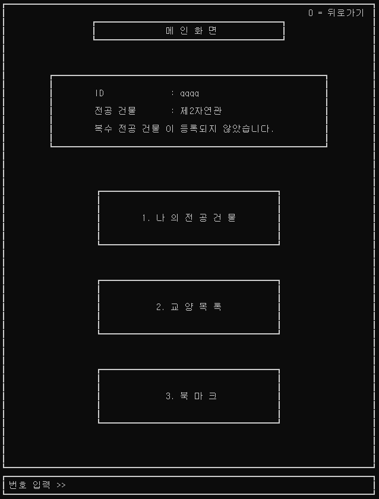
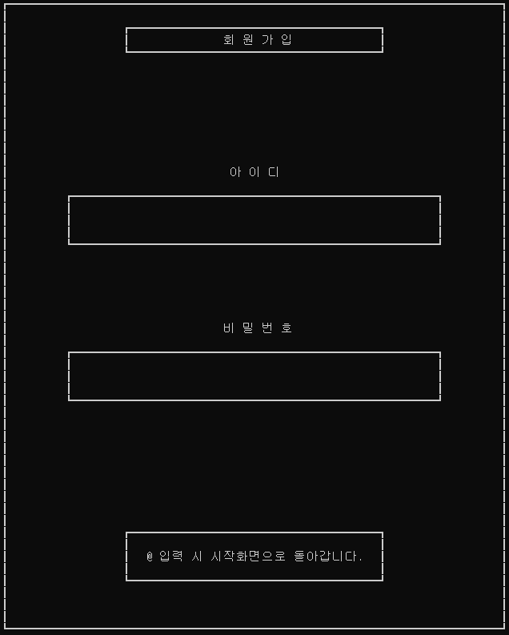
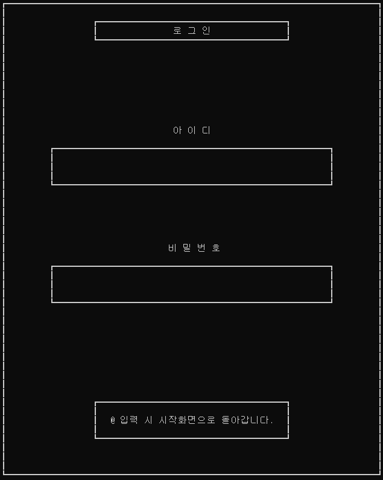
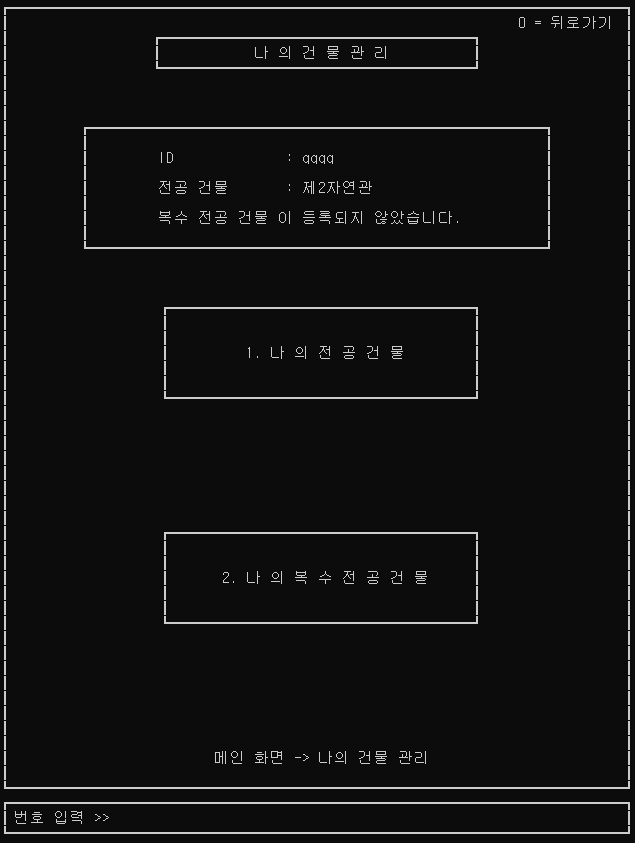
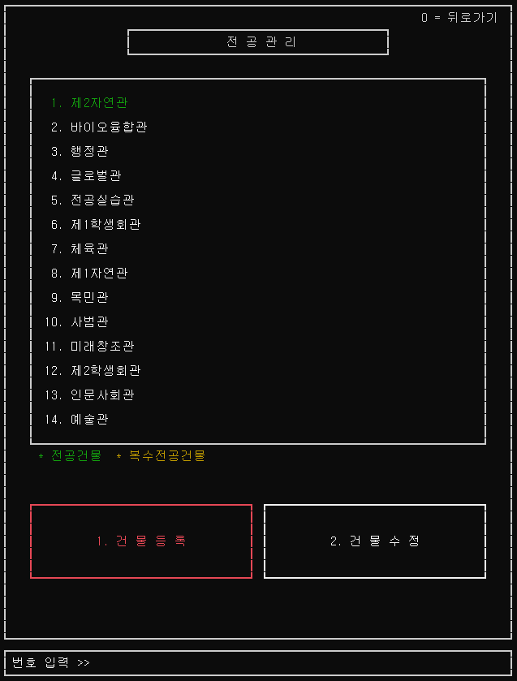
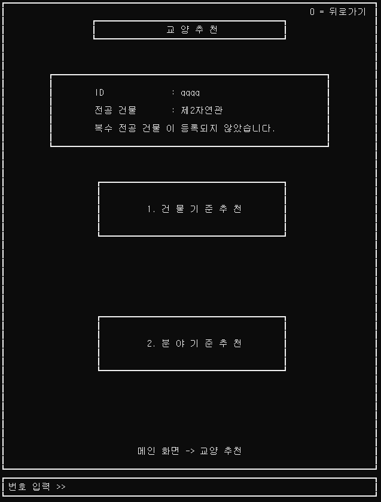
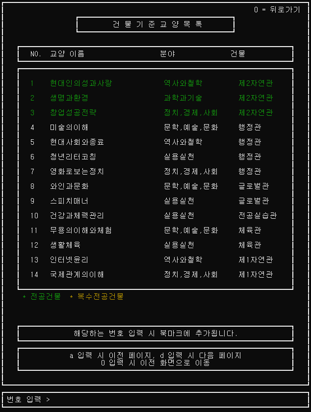
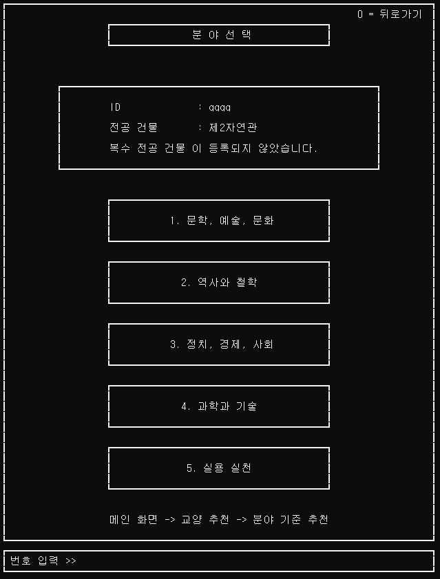
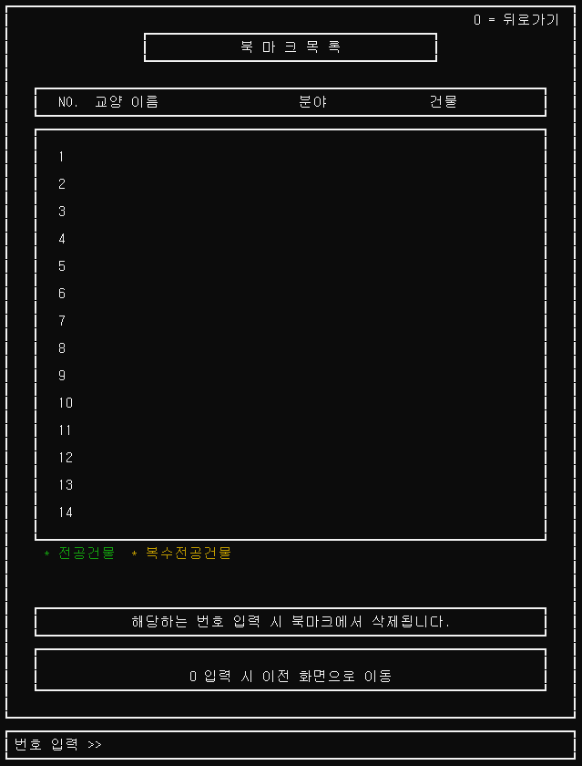

# Dijkstra Course Finder

**다익스트라 알고리즘을 활용한 교양 과목 추천 프로그램**

프로젝트 기간: **2024.02 ~ 2024.06**

전공 수업을 듣는 건물에서 가까운 교양 과목을 찾아볼 수 있도록 만든 Windows 콘솔 프로그램입니다. 캠퍼스 건물과 건물 사이의 이동 비용을 그래프로 표현하고, 다익스트라 알고리즘으로 계산한 최단 거리를 기준으로 교양 과목을 정렬합니다.

C 언어로 직접 구현한 프로젝트로, 콘솔 화면 구성부터 회원 정보 관리, 교양 조회, 북마크 저장까지 텍스트 파일과 함수로 처리합니다.

## 프로그램 소개

교양 과목을 선택할 때는 관심 분야뿐 아니라 전공 수업을 듣는 건물과의 거리도 고려하게 됩니다. 이 프로그램은 사용자가 등록한 전공 건물을 기준으로 가까운 건물의 교양 과목부터 보여주어, 이동 부담을 고려한 과목 탐색을 돕습니다.

현재 포함된 데이터는 건물 **14개**, 건물 사이 연결 **22개**, 교양 과목 **49개**입니다. 추천 순서는 저장된 건물 간 가중치를 기준으로 하며, 시간표나 실제 수강 신청 시스템과는 연동하지 않습니다.

## 주요 기능

| 기능 | 설명 |
| --- | --- |
| 회원가입 및 로그인 | 사용자 계정을 생성하고 로그인합니다. |
| 전공 건물 관리 | 전공 및 복수전공 건물을 등록·변경·삭제합니다. |
| 건물 기준 교양 조회 | 선택한 전공 건물에서 가까운 건물 순으로 교양 과목을 조회합니다. |
| 분야 기준 교양 조회 | 관심 분야에 해당하는 교양 과목을 전공 건물과의 거리순으로 조회합니다. |
| 북마크 | 관심 과목을 저장하고 조회·삭제합니다. |
| 파일 저장 | 계정, 건물, 교양 과목, 거리, 북마크 정보를 텍스트 파일로 관리합니다. |

조회 가능한 분야는 다음과 같습니다.

- 문학, 예술, 문화
- 역사와 철학
- 정치, 경제, 사회
- 과학과 기술
- 실용실천

## 동작 방식

1. `node.txt`에서 건물 번호와 이름을 읽습니다.
2. `distance.txt`에서 건물 사이 연결과 가중치를 읽어 양방향 그래프를 구성합니다.
3. 다익스트라 알고리즘으로 건물 사이의 최단 이동 비용을 계산합니다.
4. 사용자의 전공 건물을 기준으로 건물을 가까운 순서대로 정렬합니다.
5. 정렬된 건물 순서에 따라 교양 과목을 표시합니다. 분야 조회에서는 선택한 분야의 과목만 표시합니다.

## 개발 환경

- 언어: C
- 운영체제: Windows
- 프로젝트: Visual Studio C++ 콘솔 프로젝트
- 프로젝트 도구 집합: MSVC v143
- 현재 프로젝트의 빌드 구성: **Debug / x64**
- 화면 구성: Windows 콘솔 API 및 `conio.h`
- 한글 인코딩: CP949 계열

## 실행 방법

### 1. Visual Studio에서 빌드하고 실행하기

Visual Studio Installer에서 다음 구성 요소를 설치합니다.

- **C++를 사용한 데스크톱 개발**
- **MSVC v143 — VS 2022 C++ x64/x86 빌드 도구**
- **Windows SDK**

Visual Studio 2026만 설치한 경우에도 이 프로젝트가 지정한 **v143 도구 집합**을 별도로 선택해야 합니다. 기존 EXE가 실행되는 것과 소스를 다시 빌드할 수 있는 것은 별개입니다.

설치 후 다음 순서로 실행합니다.

1. 저장소를 내려받습니다.
2. `알고리즘 프로젝트 기능 구현 1.sln`을 엽니다.
3. 솔루션 구성을 **Debug**, 플랫폼을 **x64**로 선택합니다.
4. 솔루션을 빌드합니다.
5. `Ctrl + F5`로 실행합니다.

빌드 대상은 최종 소스인 `Fcn+UI.c` 하나입니다. 실행 확인에 사용한 구성은 **Debug / x64**입니다.

### 2. Visual Studio를 열지 않고 실행하기

빌드된 실행 파일이 `x64\Debug`에 있고 필요한 개발용 런타임이 설치되어 있다면, Visual Studio를 열지 않고도 실행할 수 있습니다.

CMD를 열어 저장소 루트 폴더로 이동한 뒤, 다음 명령을 한 줄씩 입력합니다.

```bat
cd "알고리즘 프로젝트 기능 구현 1"
chcp 949 >nul
"..\x64\Debug\알고리즘 프로젝트 기능 구현 1.exe"
```

예를 들어 저장소를 `C:\Dijkstra_Course_Finder`에 내려받았다면, 먼저 다음 명령으로 저장소 루트로 이동합니다.

```bat
cd /d "C:\Dijkstra_Course_Finder"
```

**실행 파일 경로의 따옴표를 유지해야 합니다.** 폴더명과 실행 파일 이름에 공백이 포함되어 있습니다.

또한 데이터 파일은 현재 작업 폴더를 기준으로 읽습니다. 위와 같이 `user.txt`, `node.txt` 등이 있는 프로젝트 폴더로 이동한 후 실행해야 합니다.

### DLL 누락 오류가 발생하는 경우

현재 보관된 실행 파일은 Debug 빌드이므로 `ucrtbased.dll`과 `VCRUNTIME140D.dll`이 필요합니다. 해당 파일이 없다는 오류가 나오면 Visual Studio의 C++ 개발 도구와 Windows SDK 설치 상태를 확인합니다. 일반 Visual C++ 재배포 패키지만으로는 Debug 런타임이 제공되지 않습니다.

## 사용 순서

1. 시작 화면에서 회원가입 후 로그인합니다.
2. 전공 건물을 등록합니다. 전공 건물이 없는 계정은 로그인 후 등록 화면으로 이동합니다.
3. 메인 화면에서 **교양 목록**을 선택합니다.
4. **건물 기준** 또는 **분야 기준**으로 과목을 조회합니다.
5. 관심 과목을 북마크에 추가하고, 메인 화면의 **북마크** 메뉴에서 확인합니다.

뒤로가기와 페이지 이동은 각 화면에 표시된 안내를 따릅니다. 로그인·회원가입 화면에서는 `@`를 입력해 시작 화면으로 돌아갈 수 있습니다.

## 화면 이미지

테스트 계정 `qqqq`의 전공 건물을 **제2자연관**으로 설정한 실제 실행 화면입니다. 이미지를 클릭하면 원본 크기로 볼 수 있습니다.

### 시작과 메인 화면

시작 화면에서 로그인 또는 회원가입을 선택합니다. 로그인 후에는 등록한 건물 정보를 확인하고 건물 관리, 교양 목록, 북마크로 이동합니다.

| 시작 화면 | 메인 화면 |
| :---: | :---: |
| [](docs/images/01-start.png) | [](docs/images/04-main.png) |

### 회원가입과 로그인

아이디와 비밀번호로 계정을 생성하고 로그인합니다. 두 화면에서 `@`를 입력하면 시작 화면으로 돌아갑니다.

| 회원가입 | 로그인 |
| :---: | :---: |
| [](docs/images/02-signup.png) | [](docs/images/03-login.png) |

### 전공 건물 관리

전공 또는 복수전공 건물을 선택해 관리합니다. 건물 목록에서는 등록된 전공 건물을 초록색으로 표시합니다.

| 건물 관리 메뉴 | 전공 건물 목록 |
| :---: | :---: |
| [](docs/images/05-building-menu.png) | [](docs/images/06-building-list.png) |

### 가까운 교양 과목 찾기

교양 추천 메뉴에서 건물 기준 또는 분야 기준 조회를 선택합니다. 건물 기준 목록은 전공 건물과의 최단 거리를 기준으로 정렬되며, 같은 전공 건물에서 열리는 과목은 초록색으로 표시됩니다. 과목 번호를 입력하면 북마크에 추가할 수 있습니다.

| 교양 추천 메뉴 | 건물 기준 교양 목록 |
| :---: | :---: |
| [](docs/images/07-course-menu.png) | [](docs/images/08-courses-by-building.png) |

### 관심 분야와 북마크

분야 선택 화면에서 다섯 분야 중 관심 분야를 고를 수 있습니다. 북마크 화면에서는 저장한 과목을 확인하고 삭제할 수 있습니다. 아래 북마크 화면은 아직 과목을 저장하지 않은 상태입니다.

| 분야 선택 | 북마크 목록 — 저장 전 |
| :---: | :---: |
| [](docs/images/09-field-selection.png) | [](docs/images/10-bookmarks.png) |

## 파일 구성

```text
.
├── README.md
├── docs/
│   └── images/                  # README의 실제 실행 화면
├── 알고리즘 프로젝트 기능 구현 1.sln
├── 알고리즘 프로젝트 기능 구현 1/
│   ├── 알고리즘 프로젝트 기능 구현 1.vcxproj
│   ├── Fcn+UI.c                  # 현재 빌드 대상
│   ├── node.txt                  # 건물 번호와 이름
│   ├── distance.txt              # 건물 사이 연결과 가중치
│   ├── class.txt                 # 교양 과목명, 분야, 건물
│   ├── user.txt                  # 사용자 계정과 등록 건물
│   └── bookmark.txt              # 사용자별 북마크
└── x64/
    └── Debug/
        └── 알고리즘 프로젝트 기능 구현 1.exe
```

`x64/Debug`는 빌드 후 생성되는 경로입니다. 실행 파일과 빌드 결과는 이 저장소에 포함하지 않습니다.

## 참고 사항

- Windows 콘솔 환경을 사용하는 학습 프로젝트입니다.
- 교양 정보와 건물 간 가중치는 저장된 데이터를 사용합니다.
- 계정 정보는 `user.txt`에 평문으로 저장되므로 실제 서비스에서 사용하는 비밀번호를 입력하지 않습니다.
- 확인한 실행 범위는 시작 화면 표시, 로그인 화면 진입, 시작 화면 복귀입니다. 전체 기능 검증은 별도로 진행해야 합니다.
